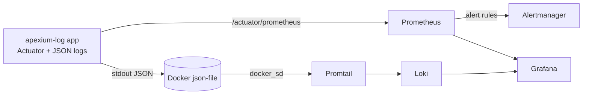

# Observability

apexium.log ships a local observability stack: **Prometheus** for metrics, **Loki + Promtail** for logs, **Grafana** for dashboards, and **Alertmanager** for alert routing. Everything starts with the normal `docker compose up` stack.

## Architecture



| Component | URL | Purpose |
|---|---|---|
| Grafana | http://localhost:3000 | Dashboards + log explorer (`admin` / `admin` by default) |
| Prometheus | http://localhost:9090 | Metrics storage, scrape targets, alert rules |
| Alertmanager | http://localhost:9093 | Alert routing / silencing |
| Loki | http://localhost:3100 | Log storage/query API |
| App metrics | http://localhost:8080/actuator/prometheus | Raw Prometheus exposition |
| App health | http://localhost:8080/actuator/health | Liveness/readiness probe |

## Quick start

```bash
./apexium start          # starts app + infra + observability stack
# or
docker compose up -d --build
```

Then:

1. Open Grafana at http://localhost:3000.
2. Go to **Dashboards → Apexium → Apexium.log Overview**. It is provisioned automatically — no manual import.
3. Open http://localhost:9090/targets and confirm the `apexium-app` target is `UP`.

Grafana credentials come from `GRAFANA_ADMIN_USER` / `GRAFANA_ADMIN_PASSWORD` in `.env` (defaults `admin` / `admin`). Change the password outside local development.

## Metrics

The app exposes Micrometer metrics through Spring Boot Actuator (`micrometer-registry-prometheus`). Every meter carries `application` and `environment` common tags.

Endpoints:

- `/actuator/health` — public
- `/actuator/prometheus` — public, scraped by Prometheus every 15s
- `/actuator/metrics`, `/actuator/info` — require authentication

Key series:

| Metric | Meaning |
|---|---|
| `http_server_requests_seconds_count` | Request throughput by `uri`, `status`, `method` |
| `http_server_requests_seconds_bucket` | Latency histogram (p50/p95/p99) |
| `jvm_memory_used_bytes` / `jvm_memory_max_bytes` | Heap / non-heap usage |
| `jvm_gc_pause_seconds_sum` | GC pause time by `cause` |
| `process_cpu_usage` / `system_cpu_usage` | CPU usage |
| `hikaricp_connections_active` | DB pool saturation |
| `up{job="apexium-app"}` | Scrape health |

### Adding a custom metric

```kotlin
@Service
class TraceJobMetrics(private val registry: MeterRegistry) {
    fun recordJob(org: String, success: Boolean) {
        Counter.builder("apexium.tracejob.runs")
            .tag("org", org)
            .tag("result", if (success) "success" else "failure")
            .register(registry)
            .increment()
    }
}
```

Keep tag values low-cardinality — never put user ids, request ids, or raw URLs in tags.

## Logs

Logs are emitted as **structured JSON** on stdout when the `docker` Spring profile is active (`SPRING_PROFILES_ACTIVE=docker`, set by `docker-compose.yml`). Locally (`./mvnw spring-boot:run`) the normal human-readable pattern is used.

Example line:

```json
{"timestamp":1792456248503,"level":"INFO","threadName":"http-nio-8080-exec-1","loggerName":"c.o.s.controller.SalesforceLogController","mdc":{"requestId":"9b2f..."},"formattedMessage":"Fetched 120 logs","throwable":null}
```

Promtail (Docker service discovery) reads container logs, unwraps the Docker envelope, parses the JSON, and promotes `level` and `logger` to Loki labels. `service` is the Compose service name (`app`, `db`, …).

### Query examples in Grafana Explore (Loki)

```logql
{service="app"}                          # all app logs
{service="app"} |= "ERROR"               # substring search
{service="app"} | json | level="ERROR"   # structured level filter
{service="app"} | json | requestId="abc" # one request's whole trace
{service="app"} | json | logger=~"c\\.o\\.s\\.service.*"
```

Correlation id: the backend accepts an `X-Request-ID` header (or generates a UUID), puts it in the MDC as `requestId`, returns it in the response header, and includes it in every log line for that request. Filter Loki by that value to see a single request end-to-end.

## Alerts

Rules live in [`observability/prometheus/alerts.yml`](../observability/prometheus/alerts.yml):

| Alert | Condition | Severity |
|---|---|---|
| `ApexiumAppDown` | `up{job="apexium-app"} == 0` for 1m | critical |
| `ApexiumHighErrorRate` | 5xx ratio > 5% for 5m | warning |
| `ApexiumHighLatencyP95` | p95 > 2s for 5m | warning |
| `ApexiumHighHeapUsage` | heap > 90% for 10m | warning |

Alertmanager receives them at `alertmanager:9093`. No notifier is wired by default — edit [`observability/alertmanager/alertmanager.yml`](../observability/alertmanager/alertmanager.yml) to add Slack/webhook/email, then `docker compose restart alertmanager`.

Check firing alerts: http://localhost:9093 and http://localhost:9090/alerts.

## Files

```
observability/
├── alertmanager/alertmanager.yml
├── grafana/
│   ├── dashboards/apexium-overview.json
│   └── provisioning/
│       ├── dashboards/dashboards.yml
│       └── datasources/datasources.yml
├── loki/loki-config.yml
├── prometheus/
│   ├── alerts.yml
│   └── prometheus.yml
└── promtail/promtail-config.yml
```

Configs are bind-mounted read-only, so editing a file and restarting the container applies it:

```bash
docker compose restart prometheus    # also reload via: curl -X POST http://localhost:9090/-/reload
docker compose restart loki promtail
docker compose restart grafana
```

## Retention and resource usage

| Store | Retention | Set in |
|---|---|---|
| Prometheus | 15 days | `--storage.tsdb.retention.time=15d` (`docker-compose.yml`) |
| Loki | 7 days | `limits_config.retention_period: 168h` + compactor (`loki-config.yml`) |
| Grafana | — | dashboards/data only |

Adjust limits before running on a machine with little disk. The stack is sized for local/dev; for staging or production, deploy Prometheus/Loki/Grafana via Helm and point them at the same `/actuator/prometheus` endpoint and stdout JSON logs.

## Troubleshooting

| Symptom | Check |
|---|---|
| Prometheus target `DOWN` with 401 | `/actuator/prometheus` must stay public in `SecurityConfig`; check `docker compose logs prometheus` |
| No logs in Grafana | `docker compose logs promtail`; confirm app runs with `SPRING_PROFILES_ACTIVE=docker` so output is JSON |
| Grafana dashboard missing | `docker compose logs grafana`; provisioning path must be `/var/lib/grafana/dashboards` |
| Loki `ready` never healthy | `docker compose logs loki`; usually a config or volume permission error |
| Alerts not visible | Prometheus → Status → Rules; confirm `alerts.yml` is mounted and reloaded |

## Security notes

`/actuator/prometheus` is intentionally unauthenticated so Prometheus can scrape it. It exposes internal metric names, URI paths, and traffic volume. Do not expose port `8080` (or the dashboard stack) directly to the internet — terminate at a reverse proxy or keep the stack on a private network. All other actuator endpoints remain authenticated.

## Adding a Grafana dashboard

1. Drop a JSON export into `observability/grafana/dashboards/`.
2. Restart Grafana (`docker compose restart grafana`) — provisioning picks it up within 30s.
3. Use datasource UIDs `prometheus` and `loki` (defined in `datasources.yml`), not names, so the dashboard stays portable.
